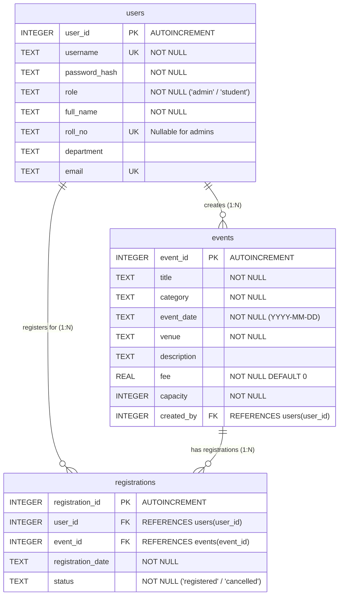

# College Event Management System (CEMS)

A complete, beginner-friendly desktop application built with **Python 3**, **Tkinter / ttk**, and **SQLite3** for managing college events and student registrations.

Developed for Python Laboratory practical examination, viva voce, and project demonstration.

---

## 📑 Table of Contents
1. [Overview & Role Separation](#1-overview--role-separation)
2. [Technology Stack](#2-technology-stack)
3. [Project Structure](#3-project-structure)
4. [Database Design & ER Diagram](#4-database-design--er-diagram)
5. [Key SQL Queries Used](#5-key-sql-queries-used)
6. [File-by-File Explanation](#6-file-by-file-explanation)
7. [Installation & Setup Instructions](#7-installation--setup-instructions)
8. [Default Login Credentials](#8-default-login-credentials)
9. [Running Automated Tests](#9-running-automated-tests)
10. [Viva Preparation Sheet](#10-viva-preparation-sheet)

---

## 1. Overview & Role Separation

The application enforces role-based access control (RBAC) in both the Python service layer and the graphical user interface.

### 🛡️ Admin / Organizer
- **Authentication**: Secure login using salted PBKDF2 password verification.
- **Dashboard Overview**: Real-time statistical cards showing total events, registered students, active registrations, and upcoming events, along with a quick-view table of upcoming events.
- **Event Management**: Create, view, search, edit, and delete events. Enforces date validation (`YYYY-MM-DD`), non-negative fees, positive capacities, and prevents capacity from being reduced below the number of active attendees. Prevents deletion of events with active registrations.
- **Student Management**: Register student accounts, assign roll numbers and departments, update details, search, and set passwords. Enforces unique usernames, roll numbers, and emails.
- **Registrations View**: Search and filter all student registrations across events with real-time status badges (Registered vs. Cancelled).

### 🎓 Student
- **Authentication**: Secure login with credentials provided by the college administrator.
- **Browse Upcoming Events**: View active upcoming events with real-time seat availability (`Capacity - Active Registrations`), event date, venue, category, and fee.
- **Event Registration**: One-click registration with atomic capacity checking inside a database transaction. Prevents duplicate registrations and past-event registrations.
- **My Registrations**: View personal registration history.
- **Cancellation & Reactivation**: Cancel active registrations with a confirmation dialog. Reactivate cancelled registrations if the event is open and seats remain.
- **Privacy & Security**: Students can only access and modify their own records.

---

## 2. Technology Stack

- **Language**: Python 3.8+ (tested on Python 3.14)
- **GUI Framework**: Built-in `tkinter` and `ttk` (Themed Tkinter)
- **Database Engine**: Built-in `sqlite3`
- **Security**: Built-in `hashlib` (PBKDF2-HMAC-SHA256) and `secrets`
- **Zero External Dependencies**: Runs entirely on Python's standard library. No `pip install` required!

---

## 3. Project Structure

```
miniProject/
│
├── main.py                     # Entry point & Tkinter screen router
├── database.py                 # SQLite schema, foreign keys & initialization
├── auth.py                     # PBKDF2-HMAC-SHA256 password hashing & login
├── test_cems.py                # Automated unittest suite verifying all requirements
├── college_events.db           # SQLite database (auto-created on first run)
├── README.md                   # Complete documentation, ER diagram, SQL queries
├── VIVA_GUIDE.md               # Quick-revision viva voce preparation guide
│
├── services/                   # Business logic & permission enforcement layer
│   ├── __init__.py
│   ├── event_service.py        # Event CRUD, validations, search & capacity checks
│   ├── student_service.py      # Student account creation, updates, and lookups
│   └── registration_service.py # Transactional registration, cancellation & stats
│
└── ui/                         # User interface presentation layer
    ├── __init__.py
    ├── login.py                # Centered login card & mask toggling
    ├── admin_dashboard.py      # Dark navy sidebar & overview stat cards
    ├── student_dashboard.py    # Student event browser & registration portal
    ├── event_page.py           # Admin event management table & form
    ├── student_page.py         # Admin student management table & form
    └── registration_page.py    # Admin registrations viewer & event filter
```

---

## 4. Database Design & ER Diagram

The database consists of **three normalized tables** in 3rd Normal Form (3NF). SQLite foreign key constraints are enabled on every connection (`PRAGMA foreign_keys = ON;`).



### Constraints & Invariants:
1. **Composite Unique Key**: `UNIQUE (user_id, event_id)` on `registrations` prevents duplicate records.
2. **Foreign Key Enforcement**: `ON DELETE CASCADE` ensures child records stay consistent.
3. **Check Constraints**: `role IN ('admin', 'student')` and `status IN ('registered', 'cancelled')`.

---

## 5. Key SQL Queries Used

### 1. Schema Creation with Foreign Keys
```sql
CREATE TABLE IF NOT EXISTS users (
    user_id INTEGER PRIMARY KEY AUTOINCREMENT,
    username TEXT UNIQUE NOT NULL,
    password_hash TEXT NOT NULL,
    role TEXT NOT NULL CHECK(role IN ('admin', 'student')),
    full_name TEXT NOT NULL,
    roll_no TEXT UNIQUE,
    department TEXT,
    email TEXT UNIQUE
);

CREATE TABLE IF NOT EXISTS events (
    event_id INTEGER PRIMARY KEY AUTOINCREMENT,
    title TEXT NOT NULL,
    category TEXT NOT NULL,
    event_date TEXT NOT NULL,
    venue TEXT NOT NULL,
    description TEXT,
    fee REAL NOT NULL DEFAULT 0,
    capacity INTEGER NOT NULL,
    created_by INTEGER,
    FOREIGN KEY (created_by) REFERENCES users(user_id) ON DELETE SET NULL
);

CREATE TABLE IF NOT EXISTS registrations (
    registration_id INTEGER PRIMARY KEY AUTOINCREMENT,
    user_id INTEGER NOT NULL,
    event_id INTEGER NOT NULL,
    registration_date TEXT NOT NULL,
    status TEXT NOT NULL CHECK(status IN ('registered', 'cancelled')),
    FOREIGN KEY (user_id) REFERENCES users(user_id) ON DELETE CASCADE,
    FOREIGN KEY (event_id) REFERENCES events(event_id) ON DELETE CASCADE,
    UNIQUE (user_id, event_id)
);
```

### 2. Events with Real-Time Seat Availability Calculation
```sql
SELECT 
    e.event_id,
    e.title,
    e.category,
    e.event_date,
    e.venue,
    e.description,
    e.fee,
    e.capacity,
    COALESCE(reg.active_count, 0) AS registered_count,
    (e.capacity - COALESCE(reg.active_count, 0)) AS available_seats
FROM events e
LEFT JOIN (
    SELECT event_id, COUNT(*) AS active_count
    FROM registrations
    WHERE status = 'registered'
    GROUP BY event_id
) reg ON e.event_id = reg.event_id
WHERE e.event_date >= date('now', 'localtime')
ORDER BY e.event_date ASC;
```

### 3. Capacity Check & Registration Insert (Atomic Transaction)
```sql
-- Step A: Check capacity limit
SELECT COUNT(*) AS active_count 
FROM registrations 
WHERE event_id = ? AND status = 'registered';

-- Step B: Insert or Reactivate
INSERT INTO registrations (user_id, event_id, registration_date, status)
VALUES (?, ?, ?, 'registered');
```

### 4. Admin Registrations with Multi-Table JOIN
```sql
SELECT 
    r.registration_id,
    r.user_id,
    r.event_id,
    r.registration_date,
    r.status,
    u.full_name AS student_name,
    u.roll_no,
    u.department,
    u.email,
    e.title AS event_title,
    e.category,
    e.event_date,
    e.venue
FROM registrations r
JOIN users u ON r.user_id = u.user_id
JOIN events e ON r.event_id = e.event_id
WHERE (u.full_name LIKE ? OR u.roll_no LIKE ? OR e.title LIKE ?)
ORDER BY r.registration_date DESC;
```

### 5. Admin Dashboard Aggregate Statistics
```sql
SELECT COUNT(*) AS total_events FROM events;
SELECT COUNT(*) AS total_students FROM users WHERE role = 'student';
SELECT COUNT(*) AS active_registrations FROM registrations WHERE status = 'registered';
SELECT COUNT(*) AS upcoming_events FROM events WHERE event_date >= date('now', 'localtime');
```

---

## 6. File-by-File Explanation

| File | Purpose & Responsibilities |
| :--- | :--- |
| `main.py` | Application entry point. Configures the Tkinter root window, sets up modern `ttk` theme styles, centers window, initializes database, and routes between Login, Admin Dashboard, and Student Dashboard. |
| `database.py` | Manages SQLite connection pooling, enforces `PRAGMA foreign_keys = ON`, creates tables, and auto-initializes the default admin account with dynamically salted hashing. |
| `auth.py` | Contains security functions: `hash_password()` using PBKDF2-HMAC-SHA256 (100,000 iterations), `verify_password()`, and `authenticate_user()`. Ensures no plain-text passwords ever exist in memory or storage. |
| `services/event_service.py` | Encapsulates all event business logic: validation (date format, positive capacity, non-negative fee), CRUD operations, capacity decrease checks, and upcoming event queries. |
| `services/student_service.py` | Handles student registration, duplicate roll number and username validation, profile editing, and password updating. |
| `services/registration_service.py` | Enforces transactional event registration, capacity boundary checks, cancellation updates, reactivation of cancelled registrations, and privacy checks. |
| `ui/login.py` | Modern card-style login interface with username, password, show/hide toggle, error handling, and role dispatching. |
| `ui/admin_dashboard.py` | Admin portal with a dark navy sidebar (`#0f172a`), real-time statistic cards, quick-view upcoming events table, and embedded subviews. |
| `ui/event_page.py` | Admin view for events: search bar, category filter, `ttk.Treeview` with column sizing, and CRUD form with pre-population on row select. |
| `ui/student_page.py` | Admin view for students: student list table, search bar by roll/name/dept, and validated student creation/editing form. |
| `ui/registration_page.py` | Admin view for registrations: event filter dropdown, search bar, and color-tagged table (`Registered` in green, `Cancelled` in gray). |
| `ui/student_dashboard.py` | Student portal featuring upcoming events with live seat counts, event detail view, one-click registration, and "My Registrations" with cancellation. |
| `test_cems.py` | Automated testing suite verifying authentication, role enforcement, event CRUD, transactional capacity, cancellation, and student data isolation. |

---

## 7. Installation & Setup Instructions

### Prerequisites
- Python 3.8 or higher installed on your computer.
- VS Code or any preferred code editor.

### Steps to Run
1. Open PowerShell or Command Prompt in the project folder:
   ```powershell
   cd d:\Shaurya\College\DjSanghvi\sem3\PythonLab\miniProject
   ```

2. Run the application:
   ```powershell
   python main.py
   ```

3. The application will automatically create `college_events.db` and initialize the tables and initial administrator account.

---

## 8. Default Login Credentials

### 🛡️ Administrator
- **Username**: `admin`
- **Password**: `admin123`

*(You can create student accounts directly from the Admin Portal under "Manage Students")*

### 🎓 Example Student Account Creation
1. Log in as `admin`.
2. Navigate to **Manage Students** on the sidebar.
3. Fill in:
   - Full Name: `Shaurya Jain`
   - Roll Number: `60004250225`
   - Department: `Computer Engineering`
   - Username: `shaurya`
   - Password: `password123`
   - Email: `shaurya@college.edu`
4. Click **Add Student**.
5. Log out and log in with username `shaurya` and password `password123` to access the Student Portal!

---

## 9. Running Automated Tests

Run the included automated test suite to verify that all business logic, constraints, and transactions pass:

```powershell
python test_cems.py
```

Expected output:
```
......
----------------------------------------------------------------------
Ran 6 tests in 0.880s

OK
```

---

## 10. Viva Preparation Sheet

See [VIVA_GUIDE.md](file:///d:/Shaurya/College/DjSanghvi/sem3/PythonLab/miniProject/VIVA_GUIDE.md) for quick questions and answers covering:
- Tkinter architecture & event loop
- SQLite integration & foreign keys
- Relational database normalization (1NF, 2NF, 3NF)
- Password security & PBKDF2-HMAC-SHA256
- Race condition prevention using database transactions
- CRUD operations & role-based access control
