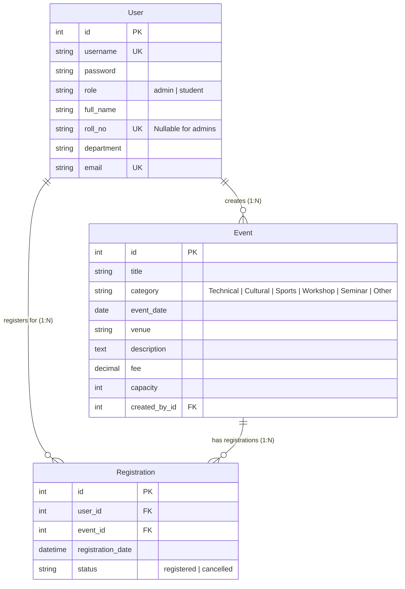

# College Event Management System (CEMS)

A full-stack Python and Django web application with a clean, light, professional interface, real-time seat availability tracking, role-based access control (RBAC), and SQLite3 persistence.

Developed for Python Laboratory coursework and project demonstration.

---

## Key Highlights

- **Professional Design System**: Clean, light interface using Source Serif 4 headings, Source Sans 3 body typography, and neutral category badges.
- **Role-Based Access Control**: Separate interfaces and permissions for administrators (organizers) and students.
- **Seat Availability Tracking**: Real-time capacity computation and progress indication across all scheduled events.
- **Atomic Concurrency Protection**: Database transactions (`transaction.atomic()`) ensure event capacity bounds cannot be exceeded during simultaneous registrations.
- **Django Messages Framework**: Inline status banners with dismiss controls for operational feedback.
- **Automated Seeding & Fixtures**: One-command sample record generation via `python manage.py seed_data` or `python manage.py loaddata sample_data.json`.

---

## 1. Quick Start & Launch Commands

### 1. Clone the Repository
```bash
git clone https://github.com/Rohit-Pandey10/Clg-EvenetManagement.git
cd Clg-EvenetManagement
```

### 2. Create and Activate Virtual Environment
On macOS / Linux:
```bash
python3 -m venv venv
source venv/bin/activate
```

On Windows (Command Prompt / PowerShell):
```powershell
python -m venv venv
venv\Scripts\activate
```

### 3. Install Dependencies
```bash
pip install -r requirements.txt
```

### 4. Apply Database Migrations
```bash
python manage.py makemigrations
python manage.py migrate
```

### 5. Seed the Database with Sample Data
Populate administrators, student profiles, sample events, and registrations:
```bash
python manage.py seed_data
```
*(Alternatively, load the included JSON fixture: `python manage.py loaddata sample_data.json`)*

### 6. Run the Development Server
```bash
python manage.py runserver
```

Open your browser and navigate to: **http://127.0.0.1:8000/**

---

## 2. Default Login Credentials

| Role | Username | Password | Full Name | Department / Roll No |
| :--- | :--- | :--- | :--- | :--- |
| **Administrator** | `admin` | `admin123` | System Administrator | Administration |
| **Student** | `alice` | `password123` | Alice Sharma | Computer Eng. (`CS2026-001`) |
| **Student** | `bob` | `password123` | Bob Patel | Info Technology (`IT2026-014`) |
| **Student** | `charlie` | `password123` | Charlie Gupta | AI & Data Science (`AI2026-022`) |
| **Student** | `diana` | `password123` | Diana Dsouza | EXTC (`EXTC2026-035`) |

---

## 3. Project Structure

```
PythonLab_MiniProject/
├── manage.py                     # Django management script
├── requirements.txt              # Project dependencies
├── sample_data.json              # Sample database fixture
├── db.sqlite3                    # Primary SQLite3 database
│
├── cems_project/                 # Django Project Configuration
│   ├── __init__.py
│   ├── settings.py               # Settings, apps, templates, and auth config
│   ├── urls.py                   # Root URL configuration
│   ├── wsgi.py                   # WSGI entry point
│   └── asgi.py                   # ASGI entry point
│
├── events/                       # CEMS Application
│   ├── models.py                 # User (AbstractUser), Event, and Registration models
│   ├── forms.py                  # Form definitions with clean validation
│   ├── views.py                  # RBAC controllers, dashboards, and transaction logic
│   ├── urls.py                   # Application routes
│   ├── admin.py                  # Django administrative interface configuration
│   ├── tests.py                  # Automated test suite
│   ├── migrations/               # Database migration files
│   └── management/
│       └── commands/
│           └── seed_data.py      # Custom database seeding command
│
├── templates/                    # Clean HTML Templates
│   ├── base.html                 # Base layout, typography, navigation, and alerts
│   ├── accounts/
│   │   ├── login.html            # Centered sign-in card with show/hide password
│   │   └── register.html         # Student registration form
│   └── events/
│       ├── admin_dashboard.html  # Metric cards, category counts, upcoming events
│       ├── event_list.html       # Admin event management table with search and filters
│       ├── event_form.html       # Create and edit event form
│       ├── student_list.html     # Student directory with search and department filter
│       ├── student_form.html     # Create and edit student form
│       ├── registration_list.html# All registrations audit table with status filter
│       ├── student_dashboard.html# Student greeting, active registrations, featured events
│       ├── browse_events.html    # Event card grid with real-time seat availability
│       └── my_registrations.html # Student registration history and cancellation
│
├── static/
│   ├── css/
│   │   └── custom.css            # Typography, CSS variables, and badge styles
│   └── js/
│       └── main.js               # Password toggling, modal handling, alert dismissal
│
├── test_cems.py                  # Standalone test script
├── main.py                       # Legacy desktop Tkinter entry point
└── VIVA_GUIDE.md                 # Viva examination preparation sheet
```

---

## 4. Database Design & Data Models

Backed by SQLite3 (`db.sqlite3`) and Django ORM:



---

## 5. User Roles

### Administrator
- **Dashboard**: High-level statistical summaries (Total Events, Registered Students, Active Bookings, Upcoming Events) and category breakdown.
- **Event Management**: Create, edit, search, filter, and delete events. Safeguards prevent deleting events with active student attendees.
- **Student Management**: Register students, edit details, and search by roll number or department.
- **Registration Audit**: Review all student registrations, filter by specific event or status, and cancel bookings if necessary.

### Student
- **Event Discovery**: Browse upcoming campus events with real-time seat counts and capacity meters.
- **Registration**: Reserve seats with atomic capacity checking.
- **My Registrations**: View active passes and cancel reservations when needed.
- **Reactivation**: Reactivate previously cancelled registrations if seats remain open.

---

## 6. Testing

Execute the automated test suite verifying models, views, RBAC permissions, capacity constraints, and cancellations:

```bash
python manage.py test
```

Expected output:
```text
Found 14 test(s).
Creating test database for alias 'default'...
..............
----------------------------------------------------------------------
Ran 14 tests in 6.638s

OK
Destroying test database for alias 'default'...
```
